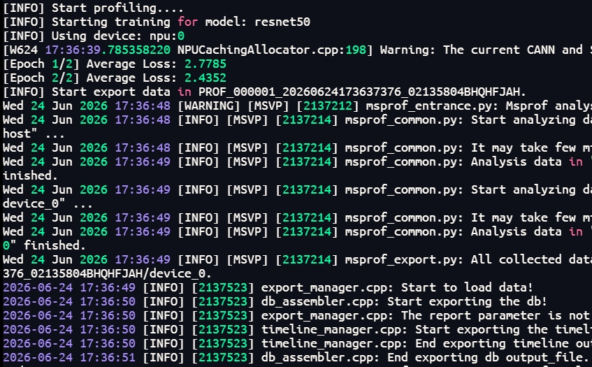
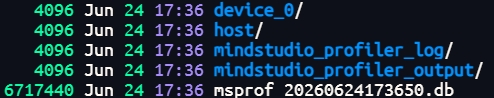

# ResNet50 Inference Model Performance Analysis

This use case uses a ResNet50 inference model as an example to demonstrate how to use the MindStudio Profiler (msProf) provided by Huawei Ascend MindStudio to collect and parse profile data and identify performance bottlenecks.

## 1. Prerequisites

### 1.1 Environment Requirements

- The Ascend NPU driver and CANN software (including the Toolkit and ops packages) are installed. For details, see [CANN Quick Installation](https://www.hiascend.com/cann/download).
- The MindStudio Insight visualization and analysis tool is installed. For details, see the [MindStudio download](https://www.hiascend.com/developer/software/mindstudio/download) page on the Ascend community website.

### 1.2 Configuring Environment Variables

Run the following command to configure the CANN environment variables (using CANN 9.1.0 as an example).

```bash
source /usr/local/Ascend/cann/set_env.sh
```

### 1.3 Verifying Tool Availability

Run the following command to verify the installed version of msProf.

```bash
msprof --version
```

Also verify the NPU device status to ensure that the NPU is functioning properly.

```bash
npu-smi info
```

### 1.4 Preparing the ResNet50 Inference Script

Ensure that the `resnet50_infer.py` inference script can run properly on an Ascend NPU. The script must include model loading, data preprocessing, and inference execution logic.

## 2. Using the Tool

### 2.1 Collecting Profile Data

Use the msProf command-line tool to collect performance data for the inference model.

```bash
msprof --output="./prof_data" --task-time=l1 python3 resnet50_infer.py
```

| Option | Description |
| --- | --- |
| `--output` | Storage path of the performance data. The default value is the directory where the AI task file resides. |
| `--task-time` | Data collection level. The default value is l0. |

The command produces the following output.



**Examples of other common commands**

```bash
# Run a Python script with arguments
msprof --output=/home/projects/output python3 /home/projects/MyApp/out/sample_run.py param1 param2

# Pass a binary executable
msprof --output=/home/projects/output /home/projects/MyApp/out/main

# Pass a binary executable and its parameters
msprof --output=/home/projects/output /home/projects/MyApp/out/main parameter1 parameter2

# Pass a shell script and its parameters
msprof --output=/home/projects/output /home/projects/MyApp/out/sample_run.sh param1 param2
```

### 2.2 Parsing Profile Data

After collection is complete, run the following command to parse the performance data and generate a report for performance analysis.

```bash
msprof --export=on --output="./prof_data"
```

After parsing, a `PROF_XXX` directory (or an `OPPROF` directory, depending on the collection mode) is generated in the directory specified by `--output`. The directory contains the automatically parsed profile data.

### 2.3 Viewing Profile Data

1. View the generated directory structure.

    ```bash
    ls -la ./prof_data/PROF_XXX/
    ```

    

    For details about the formats and deliverables of the collected and parsed data, see *[Profile Data File Reference](../user_guide/profile_data_file_references.md)*.

2. Use MindStudio Insight for visual analysis.

    Go to the `PROF_XXX/mindstudio_profiler_output` directory and import the performance data into the MindStudio Insight tool for visual analysis. MindStudio Insight provides multiple visualization options, including timeline view, communication analysis, and computation duration visualization, helping users quickly locate performance bottlenecks.

    For details, see *[MindStudio Insight System Tuning](https://gitcode.com/Ascend/msinsight/blob/26.2.0/docs/en/user_guide/system_tuning.md)*.
