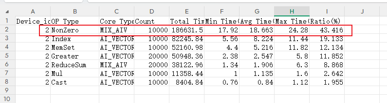
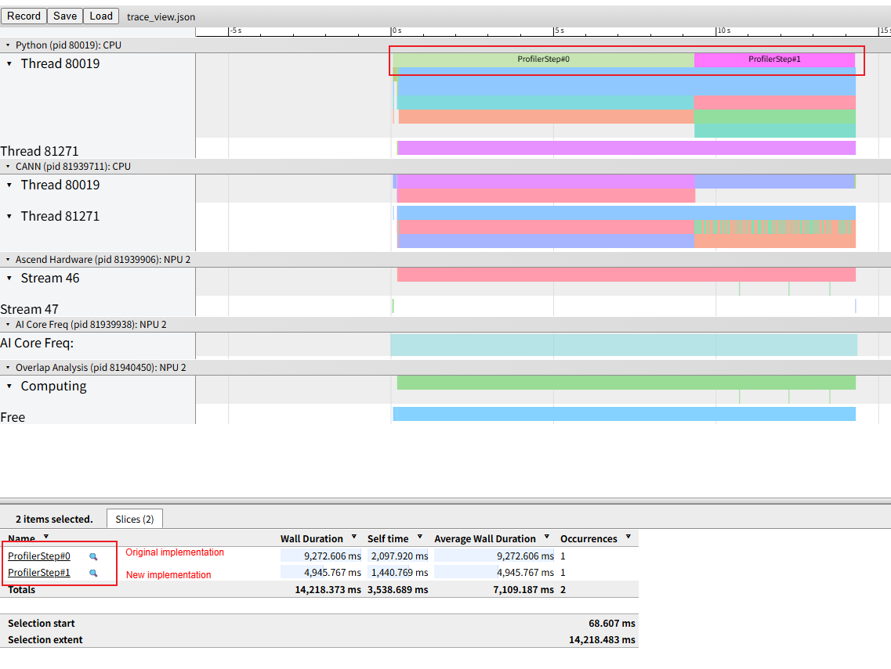

# Optimizing Operators with Long Execution Time

## 1. Background

During NPU workload execution, the execution time does not meet expectations. Profile data collection and analysis show that some operators have long execution time and require optimization.

## 2. Source

Performance tuning.

## 3. Symptoms

Open `msprof.json` or `trace_view.json` in MindStudio Insight. You can observe that some operators have long execution time.

Open `op_statistic.csv` and check the corresponding operators to confirm that their performance does not meet expectations and their execution time is long, indicating potential optimization benefits.

As shown in the following figure, the `NonZero` operator accounts for a large proportion of the total execution time.



## 4. Troubleshooting Process

Similar optimization approaches can be divided into two categories:

1. **Operator-specific optimization**: Check the operator implementation to determine whether there is room for optimization. You may need to implement the required operator capabilities yourself or contact relevant engineers for specific optimization.

2. **Operator or operation replacement**: Replace the current operator or operation with an equivalent alternative that has better NPU affinity. This section provides a brief introduction to this approach.

[NPU Affinity Adaptation](https://gitcode.com/Ascend/ModelZoo-PyTorch/blob/master/PyTorch/docs/en/performance_tuning/performance_tuning_methods/npu_affinity_opt/README.md) in *PyTorch Training Model Porting and Tuning Guide* describes many optimization methods. You can refer to similar solutions to learn about them.

For this issue, an existing "nonzero operator replacement" case is available. We refer to the official documentation and create a simple test case.

```python
import torch
import torch_npu
...

def nonzero_ori():
    shape = (1024, )
    mask= torch.randint(-1, 2, shape).npu()
    gt_inds = torch.randint(-1, 2, shape).npu()
    tensor_a = torch.ones(shape).float().npu()
    mask_inds = torch.nonzero(gt_inds > 0, as_tuple=False).squeeze(1)
    tensor_sum = tensor_a[mask_inds].sum()

def nonzero_new():
    shape = (1024, )
    mask = torch.randint(-1, 2, shape).npu()
    gt_inds = torch.randint(-1, 2, shape).npu()
    tensor_a = torch.ones(shape).float().npu()

    # --- Optimization: Completely eliminate nonzero ---
    # Directly generate a 0/1 mask (float) instead of extracting indices.
    # (gt_inds > 0) generates a BoolTensor, and .float() converts it to 0.0 and 1.0.
    float_mask = (gt_inds > 0).float()

    # Use arithmetic multiplication to perform the summation
    # tensor_a[mask_inds].sum() is mathematically equivalent to (tensor_a * float_mask).sum()
    tensor_sum = (tensor_a * float_mask).sum()


def run():
    for _ in range(10000):
        nonzero_ori()
    torch_npu.npu.synchronize()

    for _ in range(10000):
        nonzero_new()
    torch_npu.npu.synchronize()

```

The following pipeline diagram shows the performance benefit of the new implementation.



## 5. Root Cause

The nonzero operator is a commonly used indexing operator in deep learning frameworks. Its core function is to return the coordinate indices of nonzero elements in the input tensor and output the results in row-major order. This is a typical memory-access-intensive operation that is not well suited to the Ascend Da Vinci architecture. Therefore, the core replacement idea is to avoid a large number of memory access operations.

## 6. Troubleshooting Methodology Summary

1. Use visualization tools to identify operators that require optimization from perspectives such as the timeline and operator statistics tables.

2. Analyze the workload behavior of the operator and, taking the Ascend architecture into account, transform the operation into an operation better suited to the Ascend NPU architecture to improve performance.

## 7. Suggestions for Tool Improvement

None.
