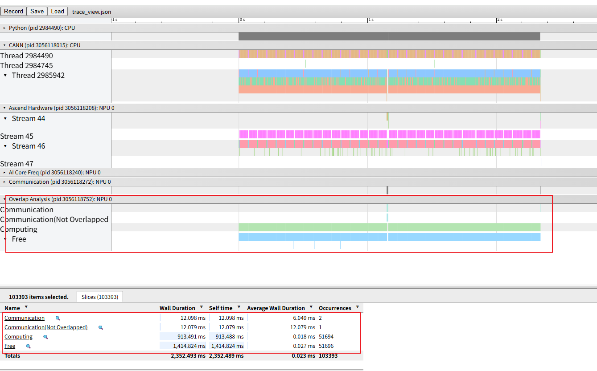
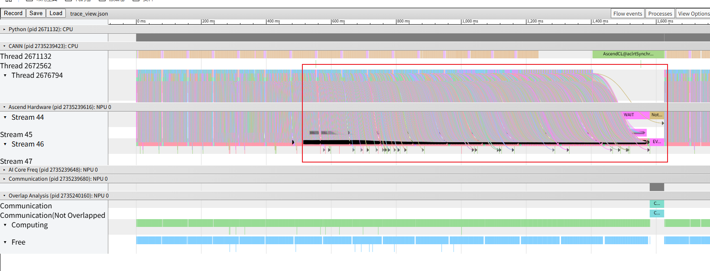
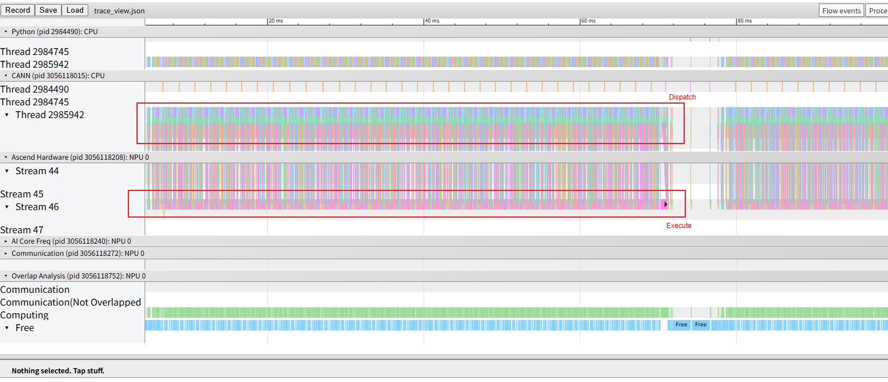
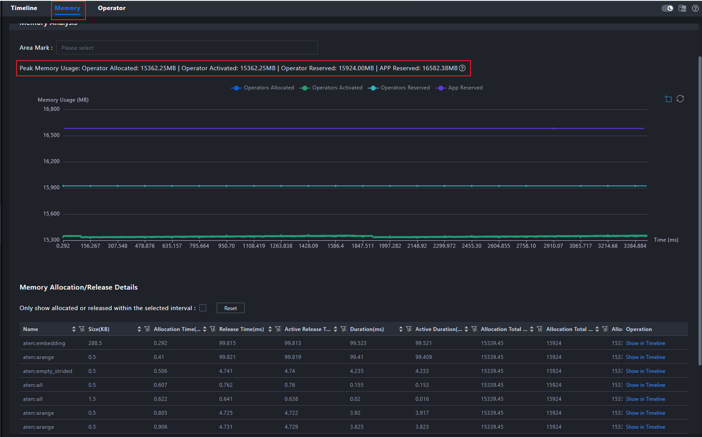

# Dispatch Performance Below Expectation

## 1. Background

During NPU workload execution, the execution time is longer than expected. Analysis of the collected profile data confirms that task dispatch is slow and overall hardware utilization is low, indicating an urgent need to identify the issue and optimize performance.

## 2. Source

Performance tuning.

## 3. Symptoms

Open `msprof.json` or `trace_view.json` in MindStudio Insight. The overall workload has a relatively high proportion of idle time and low hardware resource utilization.

## 4. Troubleshooting Process

First, the CANN layer is the API dispatch interface layer of the CANN software stack, while the Ascend Hardware layer represents the actual operator execution layer. For the overall workload, only rapid API dispatch combined with long-term high-density hardware execution constitutes a reasonable dispatch-execution relationship. This relationship can be observed through the host-to-device connection provided by the profiler. A well-optimized pipeline diagram should exhibit a certain degree of inclination, which indicates efficient utilization of hardware resources, as shown in the following figure:

However, the current connections are vertical, meaning that each operator is executed immediately after being dispatched, followed by a wait for the next operator to be dispatched. This further confirms that the hardware still has considerable utilization headroom, as shown in the following figure:

We also checked the overall memory usage of the workload and found that it was only 15 GB, while the NPU has 64 GB of memory. This indicates that the workload can fully support a larger batch size, thereby increasing the computation workload of individual operators. By increasing operator execution time, hardware resource utilization can be improved to achieve a more efficient dispatch pattern and avoid resource waste.

## 5. Root Cause

The essence of the problem is insufficient utilization of hardware resources, resulting in a certain degree of resource waste. The pipeline diagram, host-to-device connections, and memory data provided by the profiler can intuitively present the current service bottleneck and resource usage, and guide us in further adjusting the service, for example, by adjusting the batch size to improve the overall service performance.

## 6. Methodology Summary

1. Use visualization tools to identify the dispatch and execution relationship between the host and device from the timeline perspective, and use this as a basis to determine whether low resource utilization is introduced at the dispatch layer or the execution layer.

2. Analyze resource utilization based on memory usage and other data to further determine the direction for workload adjustments.

3. Increase resource utilization by adjusting the batch size based on the goal of increasing the computation workload of individual operators, thereby improving workload performance and making full use of available resources.

## 7. Tool Improvement Suggestions

Consider adding detection of memory and dispatch bottlenecks to Advisor and providing recommendations for adjusting relevant workload parameters.
