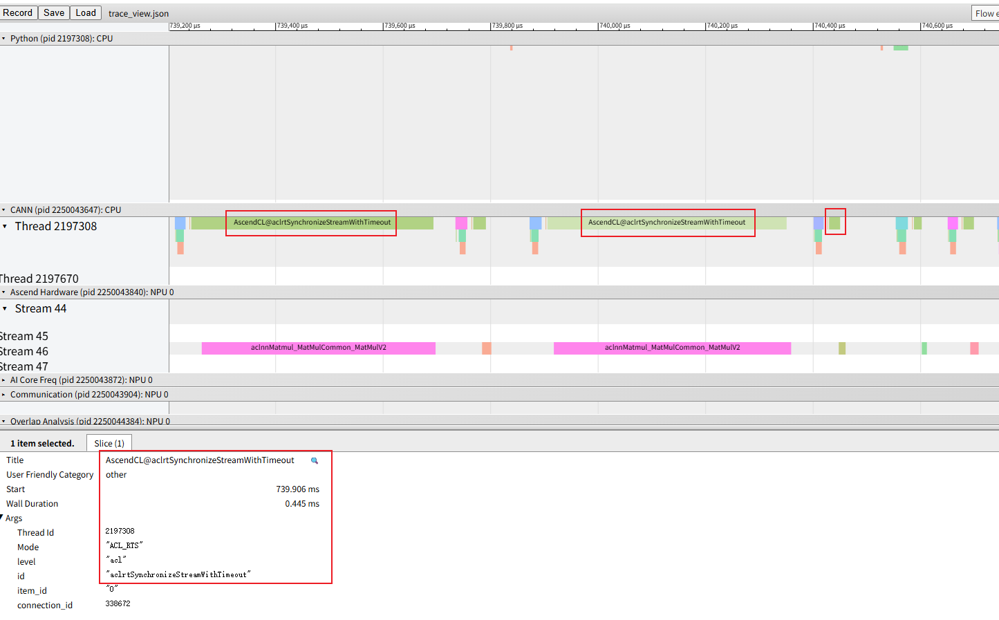
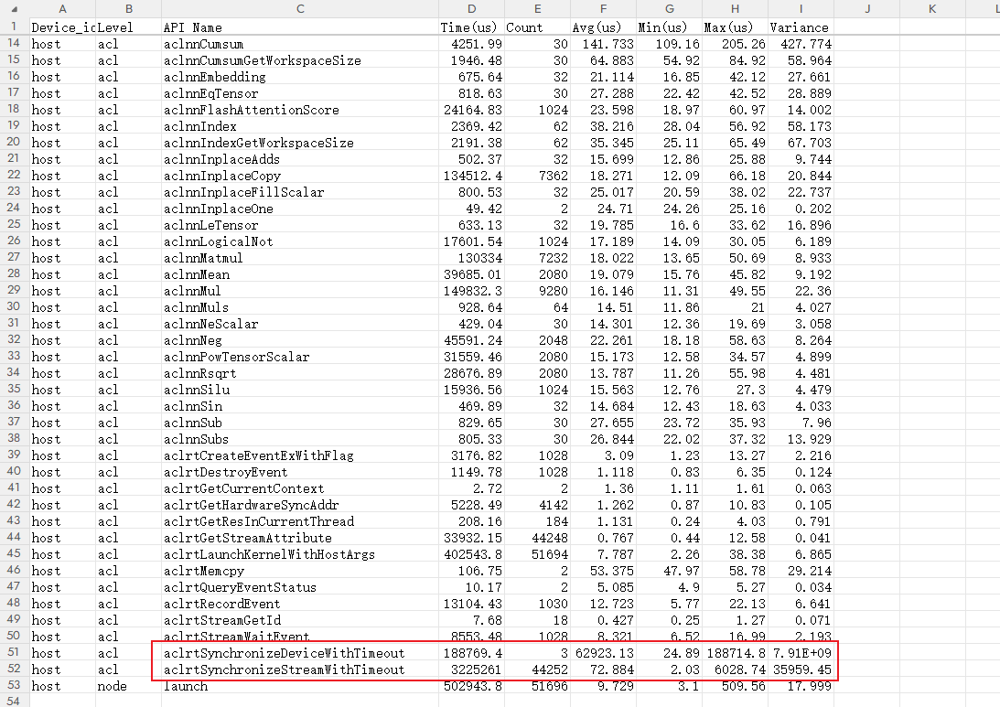
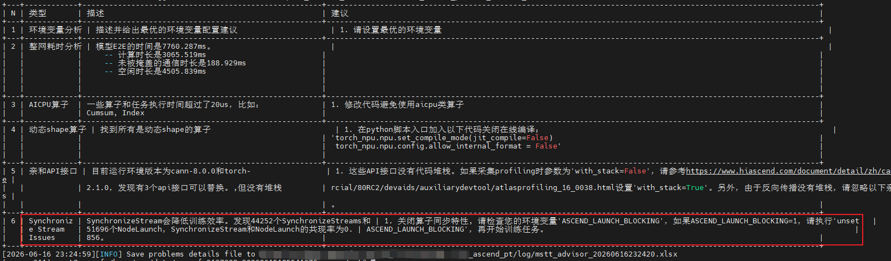

# Frequent Calls to Synchronous APIs

## 1. Background

During NPU service execution, the execution time falls short of expectations. Profiling data collection confirms that there are many waiting behaviors such as stream synchronization, which urgently require problem localization and performance optimization.

## 2. Source

Performance tuning.

## 3. Symptoms

Open the `msprof.json` or `trace_view.json` file with a visualization tool. You will find that many operators are being executed, often accompanied by synchronous interfaces such as aclrtSynchronizeStreamWithTimeout.

When a synchronous interface is being called, no other operators are dispatched, meaning that this operator blocks the dispatch of the remaining operators. As a result, the overall NPU utilization is low and performance is poor. For the overall service, the asynchronous dispatch mode requires operators to be dispatched over a long period and keeps the device-side service busy executing, thereby making full use of hardware resources. However, a large number of synchronous interface calls convert asynchronous behavior into synchronous behavior, which in turn causes discontinuity in the service and reduces hardware resource utilization.

## 4. Troubleshooting Process

Open `msprof.json` or `trace_view.json` in MindStudio Insight to observe a large number of synchronization APIs with names similar to "Synchronize".

You can also see a large number of API calls in the `api_statistic.csv` deliverable.

Based on the preceding information, it can be confirmed that the service indeed contains many stream synchronization operations that do not meet expectations.

Therefore, you can use the stack call stack feature of profiler to additionally collect a set of data with stack information, and confirm from a time perspective where the related synchronization operations are introduced.

## 5. Root Cause

1. Most stream synchronization operations are introduced manually or by the application logic. Therefore, first check the workload code and evaluate the necessity of the API calls from the perspective of the workload logic. Remove unnecessary synchronization APIs as appropriate.

2. In addition, some stream synchronization services may be introduced by environment variables. For example, [ASCEND_LAUNCH_BLOCKING](https://gitcode.com/Ascend/pytorch/blob/v2.14.0-26.2.0/docs/en/api/environment_variable/ASCEND_LAUNCH_BLOCKING.md) performs stream synchronization on each operator to locate problems.

## 6. Troubleshooting Methodology Summary

1. Open `msprof.json` or `trace_view.json` through insight to identify the stream synchronization phenomenon.

2. Use `api_statistic.csv` to confirm the overall number of calls and total time consumed by synchronous interfaces, so as to evaluate the impact of synchronous interfaces on the service.

3. Use the stack capability to locate the dispatch point of the corresponding stream synchronization interface from the time perspective, quickly identify the key code segment, and evaluate the reasonableness of the synchronous interface from the service perspective.

4. Finally, use tools such as advisor to perform a comprehensive check of the data and quickly rule out some insensitive environment variable factors.

   

## 7. Suggestions for Tool Improvement

None.
